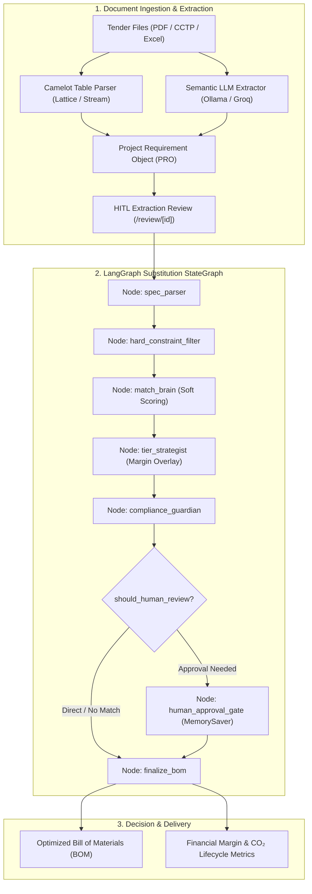

# ⚡ Engine_lighting: Intelligent Lighting Substitution & Compliance Engine

> An enterprise-grade software platform for technical lighting tenders, automated specification extraction, and multi-constraint substitution using LangGraph agentic workflows and local/cloud LLMs.

[](https://www.python.org/)
[](https://fastapi.tiangolo.com/)
[](https://langchain-ai.github.io/langgraph/)
[-black.svg)](https://nextjs.org/)
[](https://www.typescriptlang.org/)
[](https://www.docker.com/)
[](LICENSE)

---

## 📌 Executive Summary & Problem Statement

In commercial, architectural, and industrial lighting engineering, responding to tender schedules (CCTP, complex bill-of-quantities in PDF/Excel) requires cross-referencing hundreds of technical line items against manufacturer catalogs. 

Manual substitution is tedious, error-prone, and presents severe compliance risks:
* **Stringent Regulatory & Photometric Constraints:** Ingress Protection (IP rating), Color Rendering Index (CRI), Correlated Color Temperature (CCT), beam angles, and luminous efficacy ($\text{lm/W}$).
* **Margin vs. Energy Trade-offs:** Balancing distributor margins against lifecycle operating cost and carbon footprint ($kg\text{ CO}_2e$).

**Engine_lighting** automates this lifecycle by combining structured table extraction, semantic LLM analysis, deterministic constraint satisfaction, and an agentic state-machine with **Human-in-the-Loop (HITL)** governance.

---

## 🏗️ System Architecture & LangGraph State Machine



---

## 🎯 Engineering Highlights & Design Trade-offs

* **Deterministic Hard Filtering vs. Probabilistic Matching:**
  * *Design Decision:* LLMs are non-deterministic and must not be trusted for safety/regulatory constraints (e.g., electrical voltage, IP65 waterproof compliance).
  * *Implementation:* We enforce strict, zero-hallucination mathematical bounds in `hard_filter.py`, delegating only semantic text extraction and soft ranking to LLMs.
* **Hybrid Ingestion Architecture:**
  * Uses **Camelot** (`lattice`/`stream`) for dense tabular data.
  * Uses **LLMs** (`llama-3.1-8b` / `qwen2.5:7b`) with strict Pydantic JSON schema enforcement for unstructured narrative clauses.
* **Human-in-the-Loop Checkpointing:**
  * Employs LangGraph's `MemorySaver` checkpointer with `interrupt_before=["human_approval_gate"]` to halt graph execution until an engineer reviews edge-case substitutions.
* **Extraction Feedback Loop:**
  * Corrections made by engineers in the Next.js UI are persisted to PostgreSQL (`extraction_feedback`), establishing a ground-truth dataset for future fine-tuning and few-shot prompt optimization.

---

## 📂 Repository Structure

```text
Engine_lighting/
├── backend/
│   ├── app/
│   │   └── modules/
│   │       ├── ingestion/         # Document ingestion modules
│   │       └── tuning/            # Dataset exporter & feedback loop
│   ├── db/                        # Async database sessions, Redis cache & seed
│   ├── docs/                      # Technical specification documentation
│   ├── ingestion/
│   │   ├── extractors/            # PDF (PyMuPDF + Camelot) & Excel parsers
│   │   └── pro_builder.py         # Normalized Project Requirement Object builder
│   ├── matching/
│   │   ├── canonical.py           # Standardized technical attribute normalizers
│   │   ├── hard_filter.py         # Strict constraint filtering (IP, CCT, CRI, Flux)
│   │   ├── soft_scoring.py        # Multi-attribute scoring & ranking algorithm
│   │   └── overlay.py             # Tiered pricing & margin calculations
│   ├── models/
│   │   ├── domain.py              # SQLAlchemy async database models
│   │   └── schemas.py             # Pydantic v2 validation contracts
│   ├── tests/                     # Pytest unit & integration test suites
│   ├── workflow/
│   │   ├── graph.py               # LangGraph StateGraph agent definitions
│   │   └── router.py              # Asynchronous workflow API endpoints
│   ├── Dockerfile
│   ├── main.py                    # FastAPI application entrypoint
│   └── requirements.txt
├── frontend/                      # Fullstack Next.js 14 App Router client
│   ├── src/
│   │   └── app/                   # Dynamic routes: /project, /review, /finalize
│   ├── package.json
│   ├── tsconfig.json
│   └── Dockerfile
├── docker-compose.yml             # Orchestration: Backend, Frontend, Postgres, Redis, Ollama
├── .env.example                   # Clean template for environment variables
└── README.md
```

---

## 🛠️ Tech Stack & Dependencies

| Layer | Technologies |
|---|---|
| **Backend API** | Python 3.11, FastAPI, Pydantic v2, Uvicorn |
| **Agentic Workflow** | LangGraph, LangChain Core, MemorySaver |
| **Databases & Cache** | PostgreSQL 15, SQLAlchemy (AsyncPG), Redis 7 |
| **Extraction Engines** | Camelot-py, OpenCV, PyMuPDF, OpenPyXL, Pandas |
| **LLM Orchestration** | Ollama (Local `llama3.1:8b`, `qwen2.5:7b`), Groq API (`llama-3.1-8b-instant`) |
| **Frontend UI** | Next.js 14 (App Router), TypeScript, TailwindCSS, Lucide Icons |
| **DevOps & Containers** | Docker, Docker Compose, Multi-stage builds |

---

## 🚀 Quickstart & Local Setup

### Prerequisites
* [Docker](https://docs.docker.com/get-docker/) & Docker Compose (v2+)
* *(Optional)* [Ollama](https://ollama.com/) running on host machine for local LLM inference

### 1. Clone the Repository
```bash
git clone https://github.com/Achraf-sghiouar/Engine_lighting.git
cd Engine_lighting
```

### 2. Configure Environment Variables
```bash
cp .env.example .env
```
*(Optionally provide your `GROQ_API_KEY` in `.env` if using cloud inference).*

### 3. Launch Services
```bash
docker-compose up --build
```
* **Frontend Application:** [http://localhost:3000](http://localhost:3000)
* **Interactive API Documentation:** [http://localhost:8000/docs](http://localhost:8000/docs)
* **PostgreSQL:** `localhost:5432`
* **Redis:** `localhost:6379`

---

## 🧪 Automated Testing

Run the test suite inside the backend container:
```bash
docker-compose exec backend pytest tests/ -v
```
Or directly with a local virtual environment:
```bash
cd backend
pytest tests/ -v
```

---

## 🗺️ Roadmap & Next Engineering Milestones

This repository serves as an active development workspace. Upcoming features planned for implementation:

- [x] Multi-format document ingestion pipeline (Camelot + Ollama/Groq extraction).
- [x] LangGraph deterministic & probabilistic state machine with HITL checkpointing.
- [x] Interactive substitution review interface in Next.js.
- [ ] **Real-Time Agent State Streaming:** Implement Server-Sent Events (SSE) / WebSockets to stream LangGraph execution step-by-step to the UI.
- [ ] **Vector & Photometric Curve Search:** Integrate `pgvector` to match asymmetric and batwing photometric polar distribution curves (IES/LDT format).
- [ ] **Automated Compliance Dossier Generator:** Dynamic PDF rendering engine producing side-by-side technical compliance sheets for client submittals.
- [ ] **Automated Golden Dataset Benchmark:** Evaluation pipeline computing Precision@K and Recall against historical engineering substitutions.

---

## 📄 License
MIT License. Developed by Achraf Sghiouar.
